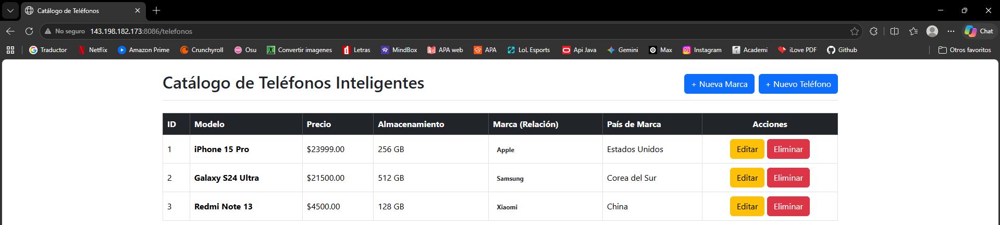
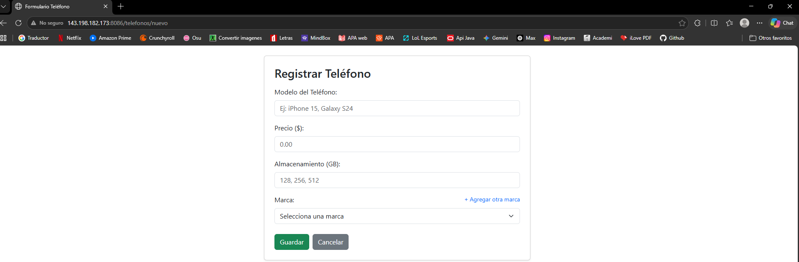
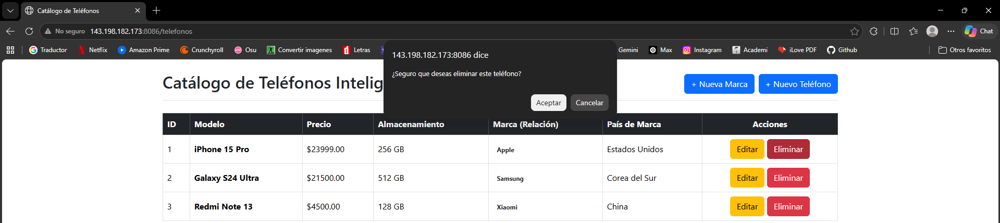
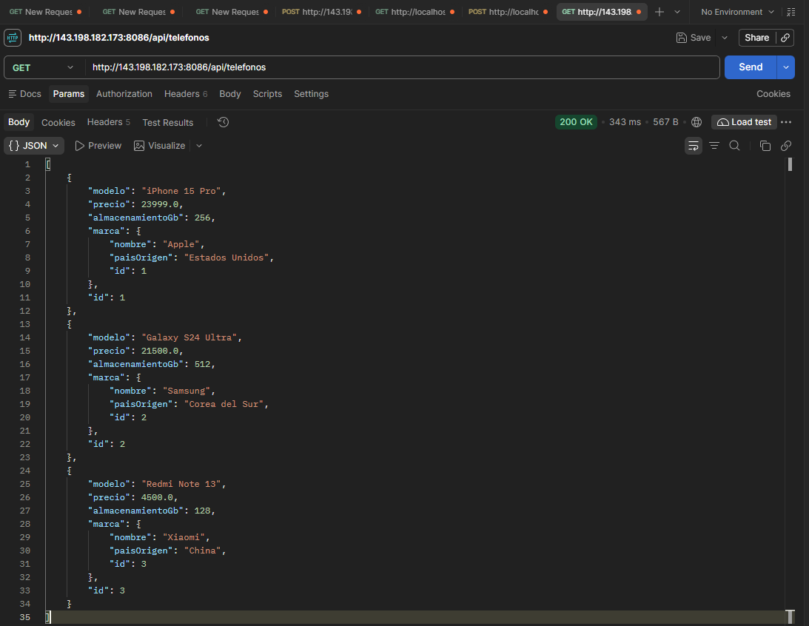

# Actividad 3: CRUD Completo con Spring Boot, JPA, MySQL y Relaciones

- **Actividad:** MVDact3_t4
- **Materia:** Programación Web 
- **Autor:** Dante Martínez Villalobos
- **Tecnologías:** Java 17, Spring Boot, Spring Data JPA, Hibernate, Thymeleaf, MySQL, Bootstrap 5.
- **Puerto VPS:** 8086
- **Servidor VPS:** `143.198.182.173`

---

## 1. Descripción del Proyecto

Aplicación web y API REST desarrollada con **Spring Boot** y **Spring Data JPA**, conectada a una base de datos relacional **MySQL**. El sistema implementa un modelo de datos con integridad referencial entre dos entidades principales:

- **`Marca`**: Representa a la compañía fabricante de un teléfono.
- **`Telefono`**: Representa los teléfonos registrados en el inventario.

El proyecto cuenta con una separación estricta en capas (Controlador, Servicio, Repositorio, Entidad), las credenciales son mediante variables de entorno en `application.properties`, vistas con **Thymeleaf** para todas las operaciones CRUD y controladores **REST** listos para consumo (Postman / Bruno).

---

## 2. Modelo de Datos y Relación JPA

La relación establecida es de **Uno a Muchos (`@OneToMany`)** desde `Marca` hacia `Telefono`, y de **Muchos a Uno (`@ManyToOne`)** desde `Telefono` hacia `Marca`.

---

## 3. Endpoints del Sistema

### Vistas Web - `TelefonoController`
| Método | Endpoint | Descripción |
| :--- | :--- | :--- |
| `GET` | `/telefonos` o `/telefonos/listar` | Lista todos los teléfonos mostrando la marca relacionada. |
| `GET` | `/telefonos/nuevo` | Formulario para registrar un nuevo teléfono vinculando una marca. |
| `POST` | `/telefonos/guardar` | Persiste el teléfono (creación o actualización) en MySQL. |
| `GET` | `/telefonos/editar/{id}` | Formulario prellenado con los datos de un teléfono para su edición. |
| `GET` | `/telefonos/eliminar/{id}` | Remueve el teléfono especificado por su ID en MySQL. |
| `GET` | `/telefonos/marcas/nueva` | Formulario para registrar una nueva marca fabricante. |
| `POST` | `/telefonos/marcas/guardar` | Persiste la marca en la base de datos. |

### API REST - `TelefonoRestController`
| Método | Endpoint | Descripción |
| :--- | :--- | :--- |
| `GET` | `/api/telefonos` | Obtiene el listado completo en formato JSON con la marca anidada. |
| `GET` | `/api/telefonos/{id}` | Obtiene los detalles de un teléfono específico por ID. |
| `POST` | `/api/telefonos` | Registra un nuevo teléfono enviando un JSON. |
| `PUT` | `/api/telefonos/{id}` | Actualiza un teléfono existente por ID. |
| `DELETE` | `/api/telefonos/{id}` | Elimina el registro por ID. |

---

### Captura 1: Operación READ (Listado General con Relación Reflejada)

---

### Captura 2: Operación CREATE (Formulario y Registro de Marca / Teléfono)

---

### Captura 3: Operación UPDATE (Edición de Teléfono)

---

### Captura 4: Operación DELETE (Eliminación de Registro)

---

### Captura 5: Pruebas del Servicio REST en Postman

